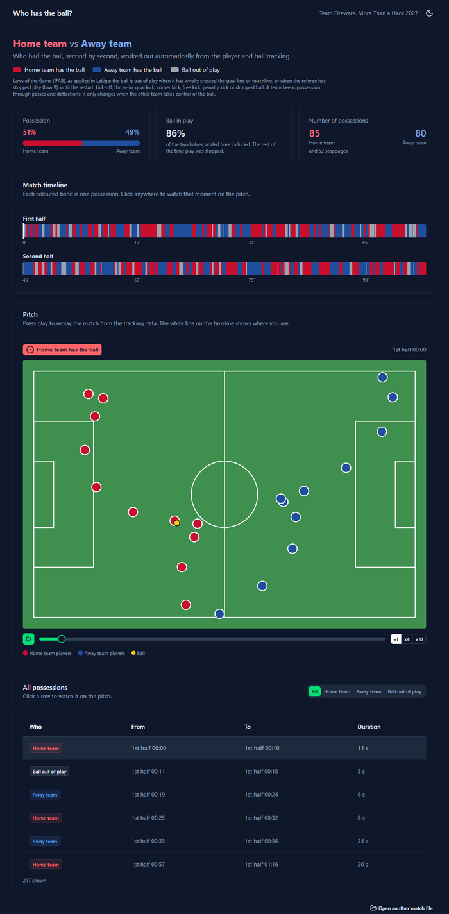
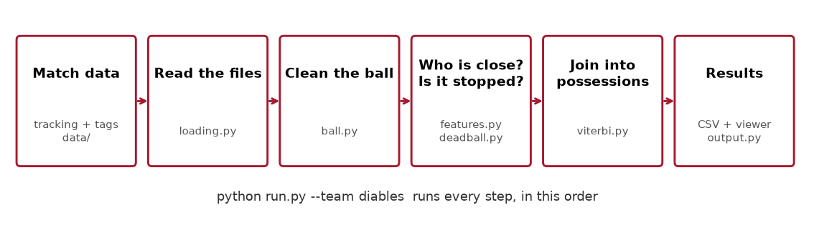
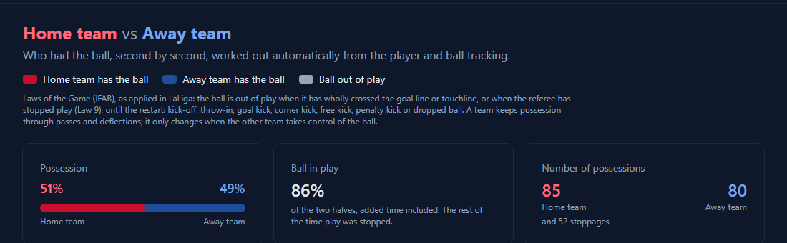
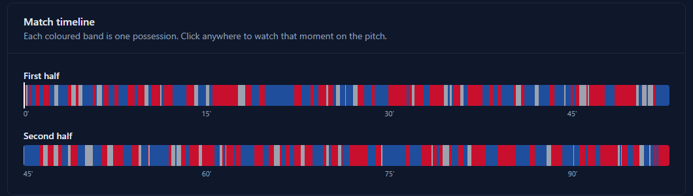
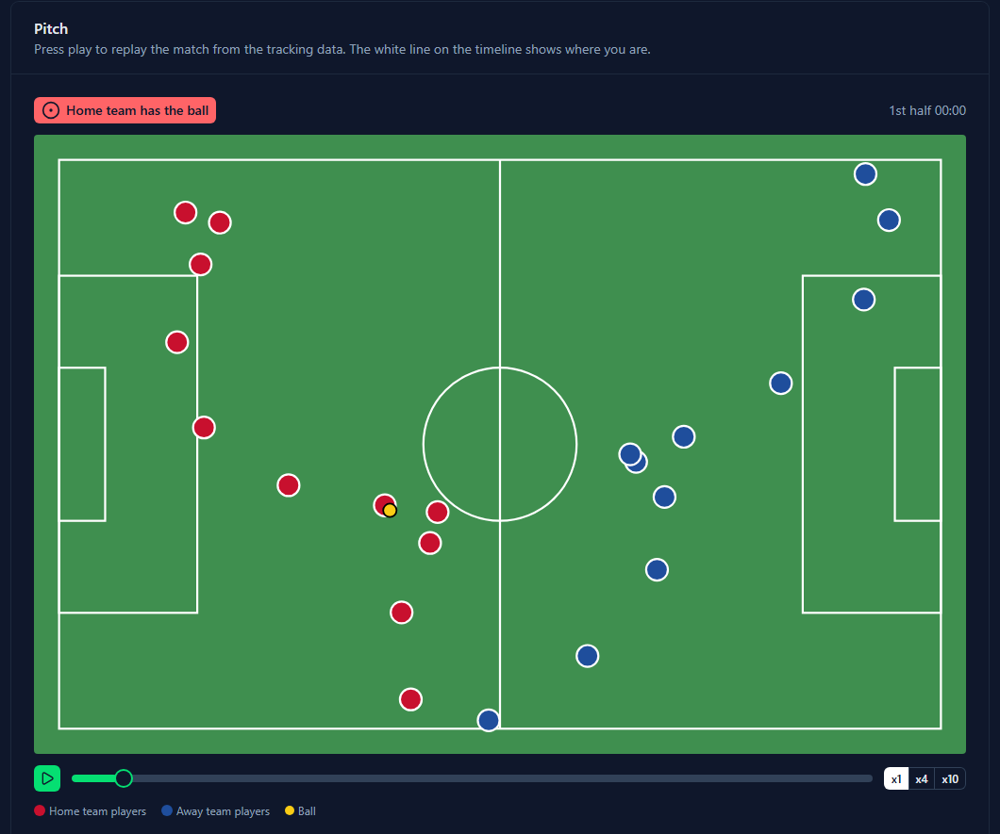
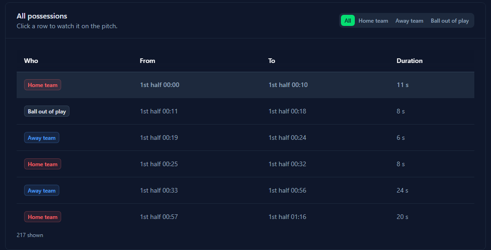
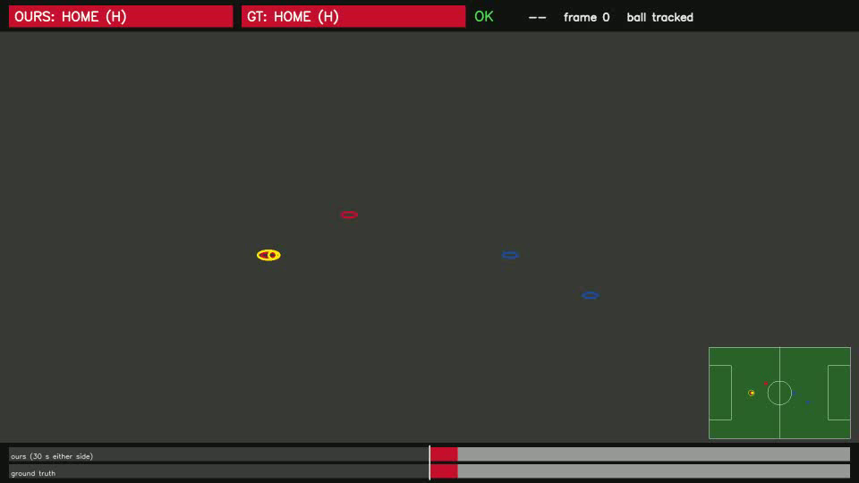
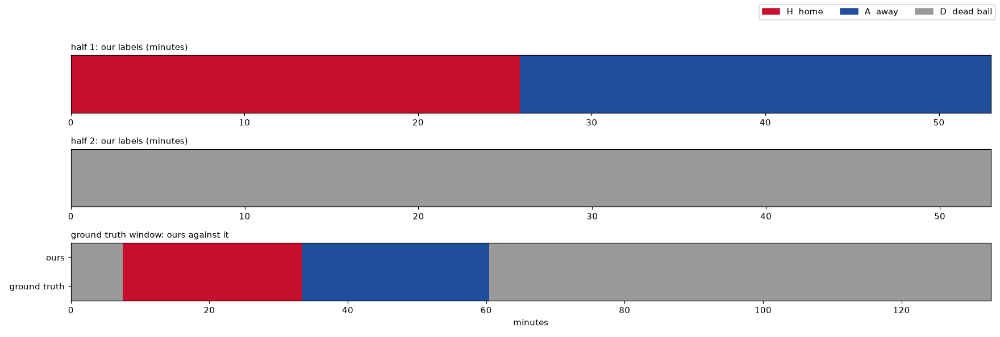

# Fireware: who has the ball?

Team Fireware (Roger, Jordi, Carles and Laia) entry for **More Than a Hack 2027, Phase 1: Ball
Possession** (Metrica Sports, Barca Innovation Hub, Mobile World Capital Barcelona).

**In one sentence:** this program watches the tracking data of FC Barcelona vs Athletic Club and
says, for every moment of the match, which team has the ball or whether play is stopped.



*All screenshots in this README use an invented demo match, not the real one: the real match data
is private and cannot be published.*

**Contents**

1. [What it does](#1-what-it-does)
2. [How it works, in plain words](#2-how-it-works-in-plain-words)
3. [Run it yourself, step by step](#3-run-it-yourself-step-by-step)
4. [See the result in the viewer](#4-see-the-result-in-the-viewer)
5. [Check it against the video](#5-check-it-against-the-video)
6. [What is in each folder](#6-what-is-in-each-folder)
7. [If something goes wrong](#7-if-something-goes-wrong)
8. [Words you will meet](#8-words-you-will-meet)
9. [Technical details](#9-technical-details)

## 1. What it does

The video of the match has 199319 frames (25 per second). For each one the program writes a
letter:

| Letter | Meaning |
|---|---|
| `H` | the home team (FC Barcelona) has the ball |
| `A` | the away team (Athletic Club) has the ball |
| `D` | dead ball: play is stopped (throw-in, corner, foul, goal kick, half-time...) |

The result is one file, `submission/diables.csv`, with one line per frame. That file is what the
competition scores. Everything is decided by the program; nobody labels anything by hand.

## 2. How it works, in plain words



1. **Read the files.** The organisers give the position of every player and of the ball, 25 times
   per second, plus automatic tags such as "corner kick" or "build up".
2. **Clean the ball.** The cameras lose the ball very often, usually just for a moment behind a
   player. Short gaps are filled with a straight line; long ones are left empty on purpose.
3. **Who is close? Is it stopped?** For every frame we measure how close each team is to the ball
   and how fast the ball moves. A team with a player right next to a slow ball probably has it. A
   ball outside the lines, players walking or a tagged restart mean play is probably stopped.
4. **Join into possessions.** Frame by frame guesses flicker. The last step looks at the whole
   match at once and finds the most likely sequence of possessions, refusing possessions shorter
   than 1.8 seconds. In football terms: a quick touch or a deflection is not a change of
   possession, as in the Laws of the Game.
5. **Results.** The file for the competition, and a web page to look at the result.

The full explanation, with the reasoning behind every choice, is in the technical document:
[docs/diables.md](docs/diables.md).

## 3. Run it yourself, step by step

You need a Windows, Mac or Linux computer, about 4 GB of free memory and the match data bundle
(the organisers send it by email to registered participants).

**Step 1. Install Python.** Download Python 3.13 from https://www.python.org/downloads/ and install
it. On Windows, tick **"Add python.exe to PATH"** on the first screen of the installer.

**Step 2. Get this repository.** Either click the green **Code** button on GitHub and choose
**Download ZIP**, then unzip it; or, if you use git:

```bash
git clone https://github.com/diablesdigualada-gestio/Bar-aHackaton.git
```

**Step 3. Put the match data in place.** Unzip the data bundle into the `data` folder so that it
looks like this:

```
Bar-aHackaton/
    data/
        tactical/
            BAR-ATH_tactical_atd.txt
            BAR-ATH_tactical_atd.xml
            BAR-ATH_tactical_smart_tagging.xml
            BAR-ATH_tactical_homography.csv      (only needed for the video check)
            BAR-ATH_tactical.mp4                 (only needed for the video check)
```

**Step 4. Open a terminal in the project folder.** On Windows: open the folder in File Explorer,
click the address bar, type `powershell` and press Enter. On Mac: right click the folder and choose
"New Terminal at Folder".

**Step 5. Install the one library it needs:**

```bash
pip install -r requirements.txt
```

**Step 6. Run it:**

```bash
python run.py --team diables
```

The first run takes a couple of minutes because it reads the raw tracking file; later runs take a
few seconds. When it finishes it prints where it wrote the file: `submission/diables.csv`.

**Step 7 (optional). Check the file** with the organisers' validator, from their repository
(https://github.com/metrica-sports/more-than-a-hack-2027):

```bash
python <official-repo>/evaluation/validate_submission.py submission/diables.csv
```

It must answer `OK`. Running the program again always produces exactly the same file.

## 4. See the result in the viewer

The viewer is a web page that shows the result to anyone, no football analytics needed. It needs
Node.js (download the LTS version from https://nodejs.org).

```bash
python run.py --team diables --viewer    # also prepares the data for the page
cd web
npm ci                                   # first time only, installs the page's libraries
npm run dev
```

Then open http://localhost:3000 in your browser.

**Summary.** Who had the ball more, how much of the match the ball was in play, and how many
possessions each team had. The colours are always the same: red for the home team, blue for the
away team, grey for ball out of play.



**Match timeline.** One bar per half. Each coloured band is one possession, from left (kick-off) to
right (final whistle). Click anywhere on a bar to watch that moment on the pitch below. The white
line shows where the pitch replay is.



**Pitch.** The players (red and blue dots) and the ball (yellow) seen from above. The label at the
top left says who has the ball at that moment, and the clock at the top right shows the match time
as on TV (`45+02:13` is added time). Press play to replay; `x4` and `x10` speed it up.



**All possessions.** Every possession in order, with when it starts, when it ends and how long it
lasts. Use the tabs to see only one team or only the stoppages, and click a row to watch it.



To publish the page on a server instead of your own computer, see
[Viewer in production](#viewer-in-production).

## 5. Check it against the video

This draws our answer on top of the real match video, so you can check by eye whether it is right.
It needs two more libraries:

```bash
pip install -r requirements-viz.txt
python tools/visualize.py clip --start 11185 --seconds 60     # a one minute clip
python tools/visualize.py timeline                            # a picture of the whole match
```

`--start` is the frame to start from: 11185 is the kick-off, and each second is 25 frames (so one
minute later is 11185 + 1500 = 12685). The files appear in the `outputs` folder.



*Demo frame on a grey background; on a real clip this is drawn over the match video.* At the top:
our answer and whether the cameras see the ball. On the pitch: an ellipse under each player and a
yellow ring on the player we think has the ball. At the bottom: our answers 30 seconds before and
after, and a small pitch from above.

The timeline picture shows the whole match in one image:



The `outputs` folder is never uploaded: the clips contain match video, which may not be shared.

## 6. What is in each folder

| Folder or file | What it is |
|---|---|
| `run.py` | the program you run; it calls everything else in order |
| `possession/` | the program itself, one file per step of [section 2](#2-how-it-works-in-plain-words) |
| `possession/config.py` | every number the program uses, each one with where it comes from |
| `web/` | the viewer web page |
| `tools/visualize.py` | the video check |
| `tools/calibrate.py` | how the numbers in `config.py` were chosen, using other public matches |
| `tests/` | automatic checks that run on invented data |
| `docs/diables.md` | the technical document: what we did and why |
| `docs/submission.md` | what we hand in and how it was checked |
| `entregar/` | the files for the competition form, ready to upload |
| `data/` | where you put the match data (empty on GitHub, the data is private) |
| `submission/` | where the result file is written (not on GitHub) |

## 7. If something goes wrong

| Message | What to do |
|---|---|
| `python` is not recognized | Python is not installed or not in PATH. Reinstall it and tick "Add python.exe to PATH". |
| `match data not found` | The data is not where the program looks. Check the folder layout in step 3, or tell the program where it is: `python run.py --data D:\my\folder`. |
| `No module named numpy` | Run step 5 again: `pip install -r requirements.txt`. |
| `npm` is not recognized | Install Node.js from https://nodejs.org and open a new terminal. |
| The viewer says "No match loaded yet" | Run `python run.py --team diables --viewer` first, then reload the page. |
| The video check cannot find the video | The video must be in `data/tactical/`, named `BAR-ATH_tactical.mp4` or `BAR-ATH_tactical-001.mp4` (as downloaded). |
| The first run is slow | Normal: the raw tracking is read once and kept in `.cache/`; later runs are fast. |

## 8. Words you will meet

| Word | Meaning |
|---|---|
| frame | one image of the video; there are 25 per second |
| tracking (ATD) | the position of every player and of the ball in each frame, measured by cameras |
| Smart Tagging | automatic tags of what happens (corner kick, build up...), made by Metrica |
| homography | the formula that turns a position on the pitch into a position on the video image |
| possession (spell) | an uninterrupted stretch of time in which one team has the ball |
| dead ball | play is stopped, as defined in Law 9 of the Laws of the Game |
| spellF1 | the competition score: how many real possessions we find, with the right start and end |
| HMM, Viterbi | the method of step 4: it picks the most likely sequence of possessions for the whole match |

## 9. Technical details

Method in one paragraph: per frame, a physics model estimates how strongly each team controls the
ball (proximity, ball speed and the gap between teams; a time to reach the ball model from the
pitch control literature is also implemented), and four independent signals score how likely the
ball is dead. A **three-state explicit-duration HMM** decodes the whole match at once with Viterbi,
so short flickers never become possessions. Parameters are **calibrated on Metrica's open sample
games**, never on the challenge match. Full explanation in [docs/diables.md](docs/diables.md).
What we hand in and how it was checked: [docs/submission.md](docs/submission.md).

### Reproduction

Python 3.9+ and numpy (pinned in `requirements.txt`; the submission was made with Python 3.13 and
numpy 2.2.5). Nothing else is needed for the submission file. The data folder can also be given
with the `MTAH_DATA_DIR` environment variable. The run is deterministic: same data in, same file
out, byte for byte.

### Tests

```bash
python -m tests.test_synthetic
python -m tests.test_edges
```

`test_synthetic` runs the full pipeline on an invented match (home carries, pass, away intercepts,
ball out, restart) and checks the possessions come out as H, A, D, H. `test_edges` covers failure
paths and edge cases: malformed submission files are refused before touching the disk, broken or
out-of-range lines in the raw tracking, ball gaps that are too long or at the very start, frames
with nobody tracked, flat evidence in the decoder, simulated dropouts never touching stoppages,
the robust model never seeing ball visibility, and missing files reported by name. Each test was
checked to fail when the guard it covers is removed. Neither needs the match data.

### Viewer in production

Write `match.json` first, then build, because the build copies `public/` into the output and
precompresses it (gzip and brotli).

```bash
python run.py --team diables --viewer
cd web
npm ci
npm run build
node .output/server/index.mjs            # PORT=8080 to change the port
```

`npm run generate` gives a fully static site in `.output/public` for any static host instead.
The page also has an "Open a match file" button, so the same build can show any `match.json`.

### Code layout and owners

| Path | What | Owner |
|---|---|---|
| `possession/loading.py` | raw ATD reader, metadata, Smart Tagging, homography | Roger |
| `possession/ball.py` | ball gaps, ball speed, out of pitch | Roger |
| `possession/features.py` | distance and time to ball, control evidence | Jordi |
| `possession/viterbi.py` | explicit-duration HMM decoder | Jordi |
| `possession/config.py` | every parameter, with its source | Jordi |
| `possession/learned.py` | optional learned emissions, plain and robust | Jordi |
| `possession/deadball.py` | dead-ball evidence, tagging priors | Carles |
| `possession/output.py` | submission writer, spells, viewer export | Carles |
| `run.py` | end-to-end command | Jordi |
| `tools/visualize.py` | video overlay clips and timeline | Roger |
| `tools/calibrate.py` | calibration on Metrica open samples | Roger |
| `web/` | viewer | Carles |

### Data

The match data is not in this repository and must not be: it is gated by the organisers.
`.gitignore` excludes `data/`, the cache, the submission, the viewer JSON, local video outputs and
every video file.

## Team

Team Fireware: Roger, Jordi, Carles and Laia. Diables d'Igualada.
